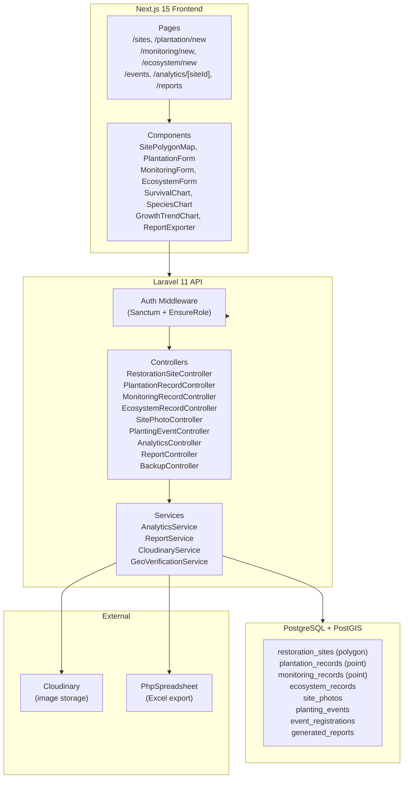

# Design Document: Mangrove Monitoring System

## Overview

The Mangrove Monitoring System extends the existing BAKAWATCH platform with structured mangrove plantation recording, survival monitoring, ecosystem data collection, community event management, GIS-based site mapping, restoration analytics, and formal report generation.

The system is built on the existing stack:
- **Backend**: Laravel 11 REST API, PostgreSQL + PostGIS, Laravel Sanctum, Cloudinary
- **Frontend**: Next.js 15 (App Router), Tailwind CSS, Leaflet.js, Chart.js, Axios

New roles (`field_worker`, `volunteer`, `menro`) are added to the existing `role` enum on the `users` table. All new modules are governed by the existing `EnsureRole` middleware pattern.

The design follows a layered approach: database → Eloquent models → API controllers → Next.js pages and components.

---

## Architecture



### Key Design Decisions

1. **Separate `restoration_sites` table from `restoration_projects`** — The existing `restoration_projects` table stores point-based project data. The new `restoration_sites` table stores polygon boundaries (PostGIS `geometry(Polygon, 4326)`) and is the spatial anchor for all new monitoring data. This avoids breaking existing functionality.

2. **Geo-verification via PostGIS `ST_DWithin`** — When a `plantation_record` is submitted, the API uses `ST_DWithin` to check whether the submitted point falls within 500 m of the site polygon. Records outside this range are stored with `status = 'flagged'` for MENRO review.

3. **Analytics computed server-side** — Survival rates, species distributions, and growth trends are computed by `AnalyticsService` using SQL aggregations rather than in-memory PHP, keeping response times low for large datasets.

4. **Excel export via PhpSpreadsheet** — Reports are generated as `.xlsx` files using `maatwebsite/excel` (which wraps PhpSpreadsheet), consistent with the existing Laravel ecosystem.

5. **Role enum migration** — The `users.role` enum is extended via a raw `ALTER TABLE` migration (PostgreSQL requires `ALTER TYPE` for enum changes), preserving all existing user records.

---

## Components and Interfaces

### Backend Controllers

| Controller | Responsibility |
|---|---|
| `RestorationSiteController` | CRUD for restoration sites, public map endpoint |
| `PlantationRecordController` | Submit/retrieve plantation records, geo-verification |
| `MonitoringRecordController` | Submit/retrieve monitoring records |
| `EcosystemRecordController` | Submit/retrieve ecosystem records |
| `SitePhotoController` | Upload/retrieve site photos via Cloudinary |
| `PlantingEventController` | CRUD for events, registration, capacity enforcement |
| `AnalyticsController` | Survival rate, species distribution, growth trend endpoints |
| `ReportController` | Generate and export reports, store generated_reports records |
| `BackupController` | Admin-only database backup trigger |

### Backend Services

| Service | Responsibility |
|---|---|
| `AnalyticsService` | SQL-based computation of survival rate, species distribution, monthly growth trend, ecosystem averages |
| `ReportService` | Assembles report data from AnalyticsService, delegates to PhpSpreadsheet for Excel export |
| `GeoVerificationService` | Wraps PostGIS `ST_DWithin` query to check point-to-polygon proximity |
| `CloudinaryService` | Existing service — reused for site photo uploads |

### Frontend Pages

| Route | Purpose |
|---|---|
| `/sites` | Map dashboard — all restoration sites as Leaflet polygons |
| `/sites/[id]` | Site detail — plantation pins, analytics charts, photo gallery |
| `/plantation/new` | PlantationForm with GPS capture and Leaflet pin preview |
| `/monitoring/new` | MonitoringForm linked to a plantation record |
| `/ecosystem/new` | EcosystemForm for environmental measurements |
| `/events` | Public listing of open planting events with registration |
| `/analytics/[siteId]` | Full analytics dashboard for a site |
| `/reports` | Report generation and Excel export UI |

### Frontend Components

| Component | Purpose |
|---|---|
| `SitePolygonMap` | Leaflet map rendering site polygons, color-coded by status, with popup on click |
| `PlantationForm` | react-hook-form + Zod form for plantation record submission with GPS capture |
| `MonitoringForm` | react-hook-form + Zod form for monitoring record submission |
| `EcosystemForm` | react-hook-form + Zod form for ecosystem record submission |
| `SurvivalChart` | Chart.js doughnut chart for survival rate |
| `SpeciesChart` | Chart.js bar chart for species distribution |
| `GrowthTrendChart` | Chart.js line chart for monthly height averages |
| `ReportExporter` | UI for selecting report type/date range and triggering Excel download |

### API Route Groups

```
Public:
  GET  /api/sites                          → all active sites (map data)
  GET  /api/events/open                    → open planting events

Authenticated (field_worker, volunteer):
  POST /api/plantation-records
  GET  /api/plantation-records/mine
  POST /api/monitoring-records
  POST /api/ecosystem-records
  POST /api/events/{event}/register

Authenticated (menro, admin):
  GET  /api/sites/{site}/plantation-records
  GET  /api/sites/{site}/monitoring-records
  GET  /api/sites/{site}/ecosystem-records
  GET  /api/sites/{site}/photos
  POST /api/sites/{site}/photos
  GET  /api/analytics/{site}
  POST /api/reports/generate
  GET  /api/reports
  GET  /api/reports/{report}/export
  POST /api/events
  PUT  /api/events/{event}

Authenticated (admin):
  POST /api/sites
  PUT  /api/sites/{site}
  GET  /api/admin/backup
```

---

## Data Models

### Migration: Extend users role enum

```sql
ALTER TYPE users_role_enum ADD VALUE 'field_worker';
ALTER TYPE users_role_enum ADD VALUE 'volunteer';
ALTER TYPE users_role_enum ADD VALUE 'menro';
```

In Laravel, this is done via a raw migration:

```php
DB::statement("ALTER TABLE users DROP CONSTRAINT users_role_check");
DB::statement("ALTER TABLE users ADD CONSTRAINT users_role_check 
    CHECK (role IN ('admin','staff','user','public','field_worker','volunteer','menro'))");
```

### Table: `restoration_sites`

```sql
CREATE TABLE restoration_sites (
    id              BIGSERIAL PRIMARY KEY,
    created_by      BIGINT NOT NULL REFERENCES users(id),
    name            VARCHAR(255) NOT NULL,
    description     TEXT,
    boundary        geometry(Polygon, 4326) NOT NULL,
    area_hectares   DECIMAL(10,4),
    barangay        VARCHAR(255),
    status          VARCHAR(20) NOT NULL DEFAULT 'planned'
                    CHECK (status IN ('planned','active','completed','suspended')),
    established_year INT,
    created_at      TIMESTAMP,
    updated_at      TIMESTAMP,
    deleted_at      TIMESTAMP
);
CREATE INDEX restoration_sites_boundary_idx ON restoration_sites USING GIST(boundary);
```

### Table: `plantation_records`

```sql
CREATE TABLE plantation_records (
    id                  BIGSERIAL PRIMARY KEY,
    restoration_site_id BIGINT NOT NULL REFERENCES restoration_sites(id),
    submitted_by        BIGINT NOT NULL REFERENCES users(id),
    species_name        VARCHAR(255) NOT NULL,
    date_planted        DATE NOT NULL,
    seedling_source     VARCHAR(255),
    image_url           VARCHAR(500),
    image_public_id     VARCHAR(255),
    location            geometry(Point, 4326) NOT NULL,
    latitude            DECIMAL(10,8) NOT NULL,
    longitude           DECIMAL(11,8) NOT NULL,
    status              VARCHAR(20) NOT NULL DEFAULT 'active'
                        CHECK (status IN ('active','flagged','dead')),
    geo_mismatch        BOOLEAN NOT NULL DEFAULT FALSE,
    mortality_date      DATE,
    created_at          TIMESTAMP,
    updated_at          TIMESTAMP
);
CREATE INDEX plantation_records_location_idx ON plantation_records USING GIST(location);
CREATE INDEX plantation_records_site_idx ON plantation_records(restoration_site_id);
```

### Table: `monitoring_records`

```sql
CREATE TABLE monitoring_records (
    id                    BIGSERIAL PRIMARY KEY,
    plantation_record_id  BIGINT NOT NULL REFERENCES plantation_records(id),
    submitted_by          BIGINT NOT NULL REFERENCES users(id),
    monitoring_date       DATE NOT NULL,
    height_cm             DECIMAL(8,2) NOT NULL,
    diameter_cm           DECIMAL(8,2) NOT NULL,
    survival_status       VARCHAR(10) NOT NULL CHECK (survival_status IN ('alive','dead')),
    growth_stage          VARCHAR(20) NOT NULL
                          CHECK (growth_stage IN ('seedling','sapling','juvenile','mature')),
    disease_observation   TEXT,
    location              geometry(Point, 4326) NOT NULL,
    latitude              DECIMAL(10,8) NOT NULL,
    longitude             DECIMAL(11,8) NOT NULL,
    created_at            TIMESTAMP,
    updated_at            TIMESTAMP
);
CREATE INDEX monitoring_records_plantation_idx ON monitoring_records(plantation_record_id);
```

### Table: `ecosystem_records`

```sql
CREATE TABLE ecosystem_records (
    id                  BIGSERIAL PRIMARY KEY,
    restoration_site_id BIGINT NOT NULL REFERENCES restoration_sites(id),
    submitted_by        BIGINT NOT NULL REFERENCES users(id),
    measurement_date    DATE NOT NULL,
    soil_salinity_ppt   DECIMAL(6,2) NOT NULL,
    water_ph            DECIMAL(4,2) NOT NULL,
    water_temp_celsius  DECIMAL(5,2) NOT NULL,
    tidal_condition     VARCHAR(10) NOT NULL
                        CHECK (tidal_condition IN ('low','mid','high','storm')),
    location            geometry(Point, 4326),
    latitude            DECIMAL(10,8),
    longitude           DECIMAL(11,8),
    created_at          TIMESTAMP,
    updated_at          TIMESTAMP
);
CREATE INDEX ecosystem_records_site_idx ON ecosystem_records(restoration_site_id);
```

### Table: `site_photos`

```sql
CREATE TABLE site_photos (
    id                  BIGSERIAL PRIMARY KEY,
    restoration_site_id BIGINT NOT NULL REFERENCES restoration_sites(id),
    uploaded_by         BIGINT NOT NULL REFERENCES users(id),
    cloudinary_url      VARCHAR(500) NOT NULL,
    cloudinary_public_id VARCHAR(255) NOT NULL,
    photo_type          VARCHAR(10) NOT NULL CHECK (photo_type IN ('before','after')),
    created_at          TIMESTAMP,
    updated_at          TIMESTAMP
);
```

### Table: `planting_events`

```sql
CREATE TABLE planting_events (
    id                  BIGSERIAL PRIMARY KEY,
    restoration_site_id BIGINT NOT NULL REFERENCES restoration_sites(id),
    created_by          BIGINT NOT NULL REFERENCES users(id),
    name                VARCHAR(255) NOT NULL,
    description         TEXT,
    scheduled_at        TIMESTAMP NOT NULL,
    location_name       VARCHAR(255),
    max_volunteers      INT NOT NULL DEFAULT 0,
    status              VARCHAR(20) NOT NULL DEFAULT 'open'
                        CHECK (status IN ('open','closed','completed','cancelled')),
    created_at          TIMESTAMP,
    updated_at          TIMESTAMP
);
```

### Table: `event_registrations`

```sql
CREATE TABLE event_registrations (
    id              BIGSERIAL PRIMARY KEY,
    planting_event_id BIGINT NOT NULL REFERENCES planting_events(id),
    user_id         BIGINT NOT NULL REFERENCES users(id),
    created_at      TIMESTAMP,
    updated_at      TIMESTAMP,
    UNIQUE (planting_event_id, user_id)
);
```

### Table: `generated_reports`

```sql
CREATE TABLE generated_reports (
    id                  BIGSERIAL PRIMARY KEY,
    generated_by        BIGINT NOT NULL REFERENCES users(id),
    report_type         VARCHAR(50) NOT NULL,
    restoration_site_id BIGINT REFERENCES restoration_sites(id),
    date_from           DATE,
    date_to             DATE,
    file_path           VARCHAR(500),
    created_at          TIMESTAMP,
    updated_at          TIMESTAMP
);
```

### Eloquent Models Summary

| Model | Table | Key Relations |
|---|---|---|
| `RestorationSite` | `restoration_sites` | hasMany PlantationRecord, EcosystemRecord, SitePhoto, PlantingEvent |
| `PlantationRecord` | `plantation_records` | belongsTo RestorationSite, User; hasMany MonitoringRecord |
| `MonitoringRecord` | `monitoring_records` | belongsTo PlantationRecord, User |
| `EcosystemRecord` | `ecosystem_records` | belongsTo RestorationSite, User |
| `SitePhoto` | `site_photos` | belongsTo RestorationSite, User |
| `PlantingEvent` | `planting_events` | belongsTo RestorationSite; hasMany EventRegistration |
| `EventRegistration` | `event_registrations` | belongsTo PlantingEvent, User |
| `GeneratedReport` | `generated_reports` | belongsTo User, RestorationSite |

### GeoVerificationService Logic

```php
// Returns true if the point is within 500m of the site polygon
DB::selectOne(
    "SELECT ST_DWithin(
        ST_GeomFromText(?, 4326)::geography,
        ST_GeomFromText(?, 4326)::geography,
        500
    ) AS within",
    [$pointWkt, $polygonWkt]
)->within;
```

If `within = false`, the plantation record is saved with `geo_mismatch = true` and `status = 'flagged'`.

### Analytics Queries (AnalyticsService)

**Survival Rate:**
```sql
SELECT
    COUNT(*) AS total,
    COUNT(CASE WHEN EXISTS (
        SELECT 1 FROM monitoring_records mr
        WHERE mr.plantation_record_id = pr.id
          AND mr.survival_status = 'alive'
    ) THEN 1 END) AS alive_count
FROM plantation_records pr
WHERE pr.restoration_site_id = ?
```

**Species Distribution:**
```sql
SELECT species_name, COUNT(*) AS count,
       ROUND(COUNT(*) * 100.0 / SUM(COUNT(*)) OVER (), 2) AS percentage
FROM plantation_records
WHERE restoration_site_id = ?
GROUP BY species_name
```

**Monthly Growth Trend:**
```sql
SELECT DATE_TRUNC('month', monitoring_date) AS month,
       ROUND(AVG(height_cm), 2) AS avg_height
FROM monitoring_records mr
JOIN plantation_records pr ON mr.plantation_record_id = pr.id
WHERE pr.restoration_site_id = ?
GROUP BY month
ORDER BY month
```

**Ecosystem Monthly Averages:**
```sql
SELECT DATE_TRUNC('month', measurement_date) AS month,
       ROUND(AVG(soil_salinity_ppt), 2) AS avg_salinity,
       ROUND(AVG(water_ph), 2) AS avg_ph,
       ROUND(AVG(water_temp_celsius), 2) AS avg_temp
FROM ecosystem_records
WHERE restoration_site_id = ?
GROUP BY month
ORDER BY month
```

---

## Correctness Properties


*A property is a characteristic or behavior that should hold true across all valid executions of a system — essentially, a formal statement about what the system should do. Properties serve as the bridge between human-readable specifications and machine-verifiable correctness guarantees.*

### Property 1: Role enforcement is universal

*For any* authenticated user whose role is not in the allowed list for a given endpoint, the API SHALL return HTTP 403.

**Validates: Requirements 1.2, 1.3, 1.4, 1.5**

### Property 2: Token invalidation on role change

*For any* user with active Sanctum tokens, after an admin changes that user's role, all previously issued tokens SHALL return HTTP 401 when used.

**Validates: Requirements 1.6**

### Property 3: Geometry storage round-trip

*For any* valid GeoJSON polygon submitted as a site boundary, and *for any* valid (latitude, longitude) pair submitted as a GeoTag, storing then retrieving the record SHALL return geometry equivalent to the submitted coordinates.

**Validates: Requirements 2.2, 3.2**

### Property 4: Site field update correctness

*For any* valid field value submitted in a site update request, the retrieved site record SHALL reflect that updated value.

**Validates: Requirements 2.3**

### Property 5: Suspended site rejects plantation records

*For any* restoration site with status `suspended`, submitting a plantation record referencing that site SHALL return a validation error and no record SHALL be stored.

**Validates: Requirements 2.4, 4.4**

### Property 6: GeoTag is required for field records

*For any* plantation record or monitoring record submission that omits `latitude` or `longitude`, the API SHALL return a validation error.

**Validates: Requirements 3.1**

### Property 7: Server timestamp is independent of client date

*For any* plantation record, monitoring record, or ecosystem record, the server-set `created_at` SHALL be set to the server's current time regardless of any client-supplied date fields.

**Validates: Requirements 4.5, 12.3**

### Property 8: Dead monitoring record sets mortality date

*For any* monitoring record submitted with `survival_status = 'dead'`, the linked plantation record's `mortality_date` SHALL be set to the `monitoring_date` of that monitoring record.

**Validates: Requirements 5.2**

### Property 9: Multiple monitoring records are preserved

*For any* plantation record, submitting N monitoring records over time SHALL result in exactly N monitoring records stored and retrievable for that plantation record.

**Validates: Requirements 5.3**

### Property 10: Retrieved records are ordered by date descending

*For any* set of monitoring records or ecosystem records retrieved for a restoration site, the returned list SHALL be ordered by their respective date field in descending order.

**Validates: Requirements 5.6, 7.4**

### Property 11: Site photo upload stores all required fields

*For any* valid site photo upload, the stored record SHALL contain non-null values for: `cloudinary_url`, `cloudinary_public_id`, `created_at`, `uploaded_by`, `restoration_site_id`, and `photo_type`.

**Validates: Requirements 6.2**

### Property 12: Photo type filter returns only matching photos

*For any* `photo_type` filter applied to a site's photo retrieval endpoint, all returned photos SHALL have `photo_type` equal to the requested filter value.

**Validates: Requirements 6.3**

### Property 13: Invalid photo formats are rejected

*For any* file submitted with a MIME type not in `[image/jpeg, image/png, image/webp]`, the upload endpoint SHALL return a validation error without attempting a Cloudinary upload.

**Validates: Requirements 6.5**

### Property 14: Analytics averages are arithmetically correct

*For any* set of ecosystem records or monitoring records for a given site and calendar month, the analytics endpoint SHALL return averages equal to the arithmetic mean of the stored values for that month, rounded to two decimal places.

**Validates: Requirements 7.5, 10.4**

### Property 15: Event registration is recorded

*For any* authenticated `volunteer` or `field_worker` registering for an open planting event, querying the event's registrations SHALL include that user's registration.

**Validates: Requirements 8.2**

### Property 16: Event capacity is enforced

*For any* planting event where the count of registrations equals `max_volunteers`, any new registration attempt SHALL return an error and no new registration SHALL be stored.

**Validates: Requirements 8.3**

### Property 17: Public events endpoint returns only open events

*For any* set of planting events with mixed statuses, the public `/events/open` endpoint SHALL return only events with `status = 'open'`.

**Validates: Requirements 8.5**

### Property 18: Cancellation triggers notifications for all registrants

*For any* planting event with N registered participants that is cancelled, exactly N notifications SHALL be dispatched — one per registered participant.

**Validates: Requirements 8.6**

### Property 19: Total planted count is accurate

*For any* restoration site, the analytics `total_planted` value SHALL equal the COUNT of plantation records associated with that site.

**Validates: Requirements 10.1**

### Property 20: Survival rate formula is correct

*For any* restoration site with plantation and monitoring records, the computed survival rate SHALL equal `(count of plantation records with at least one alive monitoring record / total plantation records) × 100`, rounded to two decimal places.

**Validates: Requirements 10.2**

### Property 21: Species distribution percentages sum to 100

*For any* restoration site with plantation records, the species distribution percentages SHALL sum to 100.00, and each species count SHALL equal the number of plantation records with that species name.

**Validates: Requirements 10.3**

### Property 22: Generated reports contain all required fields

*For any* valid report generation request (monthly, LGU, or DENR), the returned report structure SHALL contain non-null values for: total planted, total alive, total dead, survival rate, species breakdown, and average ecosystem measurements. When no data exists for the requested range, all numeric fields SHALL be zero rather than null or error.

**Validates: Requirements 11.1, 11.2, 11.3, 11.5**

### Property 23: Report generation creates an audit record

*For any* report generation, a corresponding `generated_reports` record SHALL be created containing the generator's user ID, report type, date range, and generation timestamp.

**Validates: Requirements 11.6**

### Property 24: Future dates beyond 7 days are rejected

*For any* `date_planted` or `monitoring_date` value more than 7 days in the future relative to the server's current date, the submission SHALL return a validation error.

**Validates: Requirements 12.1**

### Property 25: Out-of-boundary records are flagged

*For any* plantation record submitted with a GeoTag whose distance from the specified restoration site boundary exceeds 500 meters (as computed by PostGIS `ST_DWithin`), the stored record SHALL have `geo_mismatch = true` and `status = 'flagged'`.

**Validates: Requirements 12.2**

### Property 26: All CUD operations are audit-logged

*For any* create, update, or delete operation on `plantation_records`, `monitoring_records`, `ecosystem_records`, or `restoration_sites`, a corresponding entry SHALL be created in the `activity_logs` table.

**Validates: Requirements 12.4**

### Property 27: Successful backup logs required metadata

*For any* successful database backup operation, the resulting `activity_logs` entry SHALL contain non-null values for: completion timestamp, file size in bytes, and storage path.

**Validates: Requirements 13.2**

---

## Error Handling

### Validation Errors (HTTP 422)
All request validation failures return a consistent JSON structure:
```json
{
  "message": "The given data was invalid.",
  "errors": {
    "field_name": ["Error description."]
  }
}
```

Covered cases:
- Missing required fields (lat/lon, species_name, etc.)
- Out-of-range values (pH, salinity, coordinates, negative dimensions)
- Invalid enum values (status, growth_stage, tidal_condition, photo_type)
- Future dates beyond 7 days
- Invalid polygon geometry
- File size > 10 MB or unsupported MIME type
- Non-existent or suspended site ID

### Authorization Errors (HTTP 403)
The existing `EnsureRole` middleware returns:
```json
{ "message": "Unauthorized." }
```

### Not Found (HTTP 404)
Laravel's model binding returns 404 for non-existent resource IDs.

### Geo-Mismatch (Soft Warning)
Records with GeoTags outside the 500 m site buffer are **not rejected** — they are stored with `geo_mismatch = true` and `status = 'flagged'`. The MENRO officer reviews flagged records via a dedicated filtered endpoint.

### Cloudinary Failures
If Cloudinary upload fails, the API returns HTTP 500 with a descriptive message. The plantation record is not saved (atomic operation — upload must succeed before DB write).

### Capacity Exceeded (HTTP 422)
```json
{ "message": "This event has reached its maximum volunteer capacity." }
```

### Backup Failures (HTTP 500)
Backup failures are logged to `activity_logs` with the failure reason and return:
```json
{ "message": "Backup failed.", "error": "<reason>" }
```

---

## Testing Strategy

### Dual Testing Approach

Both unit/example-based tests and property-based tests are used. Unit tests cover specific examples, integration points, and error conditions. Property tests verify universal correctness across many generated inputs.

### Property-Based Testing

**Library**: [Pest PHP](https://pestphp.com/) with [pest-plugin-faker](https://github.com/pestphp/pest-plugin-faker) for data generation, or a dedicated PBT library such as [eris](https://github.com/giorgiosironi/eris) for PHP.

Each property test runs a minimum of **100 iterations** with randomized inputs.

Tag format for each property test:
```
// Feature: mangrove-monitoring-system, Property N: <property_text>
```

Properties to implement as property-based tests (from the Correctness Properties section):
- Property 1: Role enforcement (generate random role/endpoint pairs)
- Property 2: Token invalidation on role change
- Property 3: Geometry round-trip (generate random valid polygons and coordinate pairs)
- Property 4: Site field update correctness (generate random valid field values)
- Property 5: Suspended site rejects records (generate random suspended sites)
- Property 6: GeoTag required (generate records missing lat/lon)
- Property 7: Server timestamp independence (generate records with arbitrary client dates)
- Property 8: Dead monitoring sets mortality date (generate monitoring records with status=dead)
- Property 9: Multiple monitoring records preserved (generate sequences of N records)
- Property 10: Ordered retrieval (generate records with random dates, verify sort)
- Property 11: Photo upload field completeness (generate valid photo uploads)
- Property 12: Photo type filter (generate mixed photo_type sets, apply filter)
- Property 13: Invalid photo format rejection (generate non-accepted MIME types)
- Property 14: Analytics averages (generate random measurement sets, verify arithmetic mean)
- Property 15: Event registration recorded (generate random user/event pairs)
- Property 16: Capacity enforcement (generate events at max capacity)
- Property 17: Public events filter (generate mixed-status event sets)
- Property 18: Cancellation notifications (generate events with N registrants)
- Property 19: Total planted count (generate random plantation record sets)
- Property 20: Survival rate formula (generate plantation + monitoring record sets)
- Property 21: Species distribution sums to 100 (generate multi-species record sets)
- Property 22: Report field completeness (generate valid and empty-data report requests)
- Property 23: Report audit record (generate report requests, verify generated_reports)
- Property 24: Future date rejection (generate dates > now + 7 days)
- Property 25: Geo-mismatch flagging (generate points outside 500 m buffer)
- Property 26: Audit logging (generate CUD operations on all four tables)
- Property 27: Backup metadata logging (mock successful backup, verify log fields)

### Unit / Example-Based Tests

Focus on:
- Valid creation examples for each resource (sites, plantation records, monitoring records, ecosystem records, events)
- Access control examples (menro can retrieve all records, field_worker can retrieve own records)
- Excel export returns a valid `.xlsx` binary response
- Backup endpoint is admin-only (403 for non-admin)
- Backup failure logs error and returns 500
- Cloudinary integration (mocked) stores URL and public_id

### Frontend Testing

- Component snapshot tests for `SurvivalChart`, `SpeciesChart`, `GrowthTrendChart`
- Unit tests for Zod validation schemas in `PlantationForm`, `MonitoringForm`, `EcosystemForm`
- E2E (Playwright) smoke tests for GPS capture flow, map polygon rendering, and report export download

### Integration Tests

- PostGIS `ST_DWithin` geo-verification with real DB (test container)
- Cloudinary upload with mocked HTTP client
- Excel export file integrity (open generated file and verify sheet structure)
