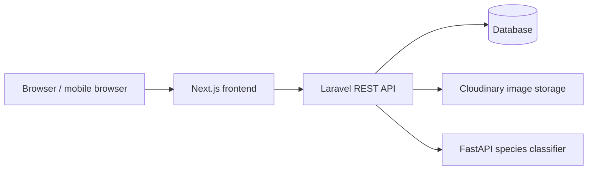

# BAKAWATCH

**BAKAWATCH** is a web based mangrove restoration and coastal ecosystem monitoring system for Gloria, Oriental Mindoro. It connects community members and field workers with MENRO staff through planting events, restoration site records, threat reports, growth monitoring, inventory, and analytics.

## System overview

The repository contains three services:

| Service | Location | Purpose |
| --- | --- | --- |
| Web application | `coastalwatch-frontend/` | Next.js and React interface for participants, Bantay Bakawan field workers, MENRO, staff, and administrators. |
| REST API | `coastalwatch-api/` | Laravel API, authentication, permissions, database access, report workflows, event registration, inventory, and notifications. |
| Species classifier | `ml-service/` | FastAPI service that runs the mangrove image species classifier. |



## Main capabilities

- **Participant accounts:** Browse planting events, register or request an event, manage requests, view joined events, and access analytics and field guides.
- **Bantay Bakawan:** Confirm event attendance, submit threat reports and follow-up updates, report event accomplishments, and record growth monitoring observations.
- **MENRO and staff:** Manage restoration sites, events, participant registrations, threat reports, report statuses and actions, inventory, announcements, articles, and generated reports.
- **Maps and field data:** View mapped sites and reports, choose locations on interactive maps, and attach geotagged photos where available.
- **Monitoring and restoration:** Track event accomplishments as planting baselines, review later monitoring updates and photo history, and record seedling inventory movements.
- **Mangrove references:** Browse species and monitoring references, practical tips, and guides.
- **Notifications and analytics:** Keep relevant users informed about report, event, and request activity, and review role-based statistics.

## Technology

- Next.js 16, React 19, TypeScript, Tailwind CSS, Axios, and Leaflet
- Laravel 13, PHP 8.3+, Laravel Sanctum, and Eloquent
- FastAPI, TensorFlow, NumPy, and Pillow for species classification
- SQLite for local development; a managed PostgreSQL or MySQL database is recommended for deployment
- Cloudinary integration for uploaded image storage

## Repository layout

```text
COASTAL WATCH/
├── coastalwatch-frontend/     # Next.js web application
├── coastalwatch-api/          # Laravel REST API and database migrations
├── ml-service/                # FastAPI mangrove species classifier
├── system-architecture.md     # System architecture notes
├── dfd-level1.md              # Level 1 data flow diagram
└── ENHANCEMENTS.md             # Enhancement notes
```

## Requirements

Install the following before starting the services:

- PHP 8.3 or newer with the PHP extensions required by Laravel, Composer, and Node.js/npm
- Python 3.10 or newer for the classifier service
- Git
- A database: SQLite for local development, PostgreSQL or MySQL for hosted use

The classifier uses TensorFlow and a trained model file. TensorFlow installation may require a compatible Python version and a machine with enough memory for model inference.

## Run locally

Open three terminals from the `COASTAL WATCH` directory.

### 1. Laravel API

```powershell
cd coastalwatch-api
Copy-Item .env.example .env
```

Configure `.env` for local use. The example file uses SQLite. Ensure `database/database.sqlite` exists, then run:

```powershell
New-Item -ItemType File -Force database/database.sqlite
composer install
php artisan key:generate
php artisan migrate --seed
php artisan serve --host=127.0.0.1 --port=8000
```

The API is available at `http://127.0.0.1:8000/api`. The development seeder installs sample records and accounts. **Use those accounts only on a private local development database. Do not seed a public production database with the default credentials.**

### 2. Next.js frontend

Create `coastalwatch-frontend/.env.local` with:

```dotenv
NEXT_PUBLIC_API_URL=http://127.0.0.1:8000/api
```

Then run:

```powershell
cd coastalwatch-frontend
npm ci
npm run dev
```

Open `http://localhost:3000`.

### 3. Mangrove species classifier (optional)

The web application can run without the classifier, but AI species detection will not be available. Configure `ML_SERVICE_URL` in the API `.env` to point to the classifier service. For local development it is:

```dotenv
ML_SERVICE_URL=http://127.0.0.1:8001
```

Start the classifier from its directory:

```powershell
cd ml-service
py -m venv .venv
.venv\Scripts\Activate.ps1
py -m pip install -r requirements.txt
py -m uvicorn main:app --host 0.0.0.0 --port 8001
```

The service health endpoint is `http://127.0.0.1:8001/`; image classification uses `POST /predict`. The classifier expects `mangrove_model.keras` and `class_labels.json` alongside `main.py`. The trained model is a large binary asset; use Git LFS or a secure model artifact store if it is too large for the repository hosting plan. Training datasets and virtual environments should not be committed.

## Environment configuration

Never commit `.env`, `.env.local`, credentials, private keys, or production secrets. Use your hosting provider's secret/environment variable settings.

Important API settings include:

| Variable | Purpose |
| --- | --- |
| `APP_ENV`, `APP_DEBUG`, `APP_URL`, `APP_KEY` | Laravel runtime and application key. Set `APP_DEBUG=false` in production. |
| `DB_CONNECTION` and database variables | Database connection. Use a managed PostgreSQL or MySQL database for deployment rather than a local SQLite file. |
| `CORS_ALLOWED_ORIGINS` | Comma separated list of allowed frontend origins, including the production HTTPS domain. |
| `FRONTEND_URL` | Frontend origin used for links such as password resets. |
| `ML_SERVICE_URL` | URL of the FastAPI classifier. |
| `CLOUDINARY_CLOUD_NAME`, `CLOUDINARY_API_KEY`, `CLOUDINARY_API_SECRET` | Image upload storage credentials. |
| `MAIL_*` | Production email provider settings for account and notification email. |
| `FIREBASE_PROJECT_ID`, `FIREBASE_CREDENTIALS` | Optional Firebase integration. Keep its service account key outside the repository. |

For the frontend, configure `NEXT_PUBLIC_API_URL` to the deployed API base URL, ending in `/api`. Values prefixed with `NEXT_PUBLIC_` are included in browser code and must never contain secrets.

## Deployment

A practical hosted layout is:

1. Deploy `coastalwatch-frontend/` to **Vercel** or another Next.js host.
2. Deploy `coastalwatch-api/` to **Railway**, **Render**, or a managed PHP host.
3. Provision managed PostgreSQL or MySQL and configure Laravel's `DB_*` variables.
4. Deploy `ml-service/` as a separate Python web service if species detection is required.
5. Configure Cloudinary (or another durable object store) for user uploads. Do not rely on a container's local filesystem for uploaded images.
6. Set `NEXT_PUBLIC_API_URL`, `CORS_ALLOWED_ORIGINS`, `FRONTEND_URL`, `ML_SERVICE_URL`, and email settings to the production service URLs.
7. Run database migrations during deployment with `php artisan migrate --force`. Seeders create sample users and data; review them and do not run them against production without removing or changing their default credentials.

If Render Shell is unavailable, you can run the starter data seeders during an API deploy. Set `ADMIN_EMAIL` to the intended administrator's Firebase sign-in email and set `ADMIN_PASSWORD` to a strong, unique secret in the Render service environment. Then set `RUN_STARTER_SITES_SEEDER=true` and save. The entrypoint runs migrations, `ProductionSeeder` (which provisions the admin), `StarterSitesSeeder`, and `StarterOperationalDataSeeder`. The operational seeder adds clearly labeled sample inventory entries, planting events, reports, and published tips/guides so each dashboard has example content; these are demonstration records, not verified field activity or official schedules. All seeders are safe to rerun without duplicating these records. The admin can sign in with the Firebase password for that email; the local `ADMIN_PASSWORD` is not the Firebase password. Remove `RUN_STARTER_SITES_SEEDER` or set it to `false` after the seeder completes, then save/restart. Do not share or commit the admin secret. Sample site coordinates and boundaries are representative, not verified survey data.

Use HTTPS for all public services. Set `APP_DEBUG=false`, generate a unique `APP_KEY`, restrict CORS to the real frontend domain, configure durable backups, and use a queue worker if queued notifications are enabled. Test the deployed login, image upload, map, events, reports, and classifier endpoints before sharing the site.

## Tests and builds

Run these from the relevant service directory when validating changes:

```powershell
# Laravel API
cd coastalwatch-api
php artisan test

# Next.js frontend
cd ..\coastalwatch-frontend
npm run build
```

## GitHub publishing checklist

- Commit `composer.json`/`composer.lock` and `package.json`/`package-lock.json` so dependencies can be installed reproducibly.
- Keep `.env` files, Firebase service account keys, API credentials, local databases, `node_modules`, `.next`, Python virtual environments, and downloaded training datasets out of Git.
- Decide whether to track the trained model with Git LFS or provide it as a versioned deployment artifact.
- Replace development seed credentials before any public deployment.
- Add a license file if you want to grant the public permission to use, modify, and distribute this project. No license is declared by this README.

## Contributing

Contributions can be proposed through GitHub issues and pull requests. Please describe the affected user role and workflow, include clear reproduction steps for bug reports, and avoid sharing real personal information or production credentials.
