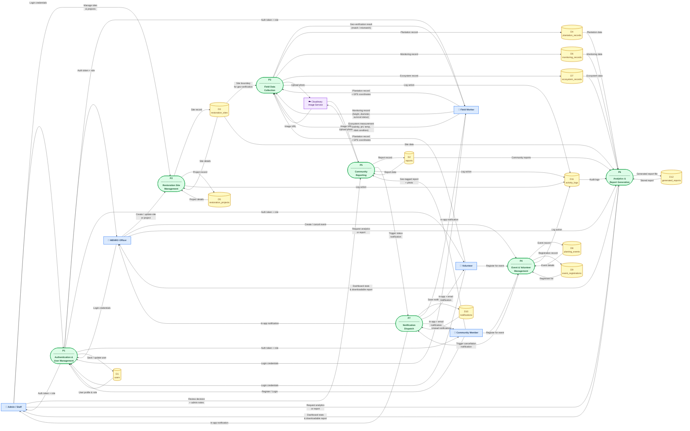

# BAKAWATCH — Data Flow Diagram Level 1

---

## Legend

| Symbol | Color | Meaning |
|--------|-------|---------|
| Rectangle (blue) | 🔵 Blue | External Entity — people or systems outside BAKAWATCH |
| Rounded rectangle (green) | 🟢 Green | Process — a function the system performs |
| Cylinder (yellow) | 🟡 Yellow | Data Store — where data is saved in the database |
| Rectangle (purple) | 🟣 Purple | External Service — third-party (Cloudinary) |

---

## Process Summary

| # | Process | Triggered By | Key Data Stores |
|---|---------|-------------|-----------------|
| P1 | Authentication & User Management | All users logging in | D1 users |
| P2 | Restoration Site Management | MENRO / Admin | D3 sites, D5 projects |
| P3 | Field Data Collection | Field Worker / Volunteer | D4 plantation, D6 monitoring, D7 ecosystem |
| P4 | Event & Volunteer Management | MENRO / Volunteer | D8 events, D9 registrations |
| P5 | Community Reporting | Community Member / Admin | D2 reports |
| P6 | Analytics & Report Generation | Admin / MENRO | D4, D6, D7, D3, D2, D11, D12 |
| P7 | Notification Dispatch | P4 (cancellation), P5 (report review) | D10 notifications |
